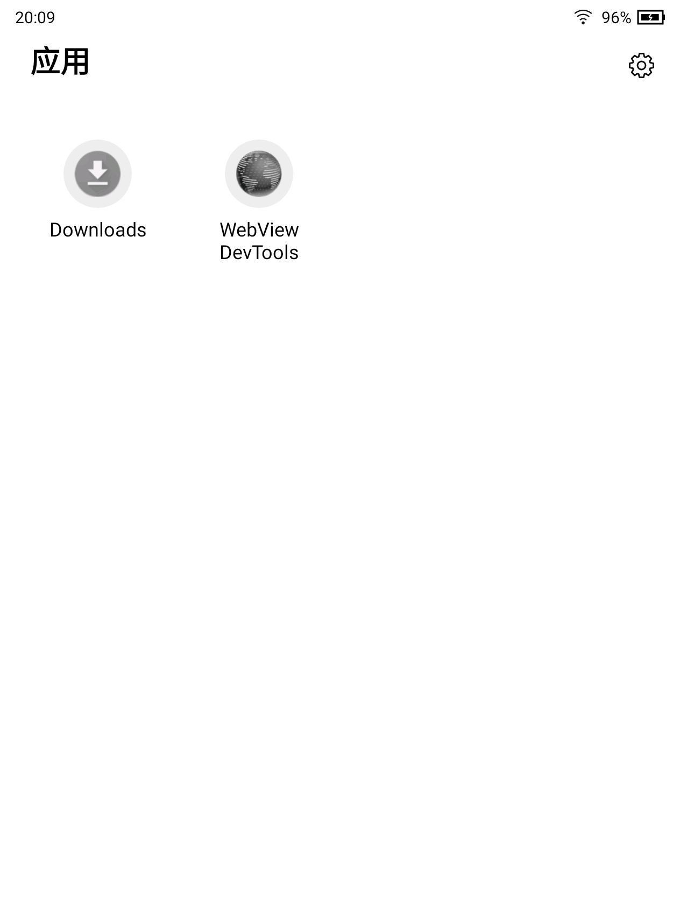
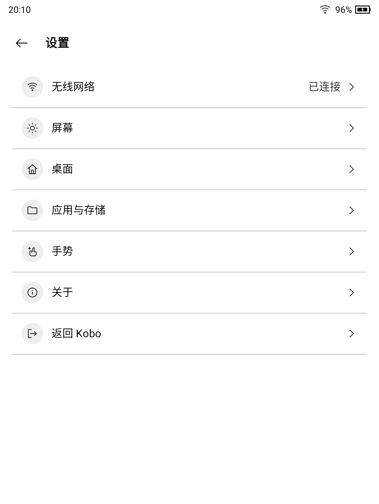
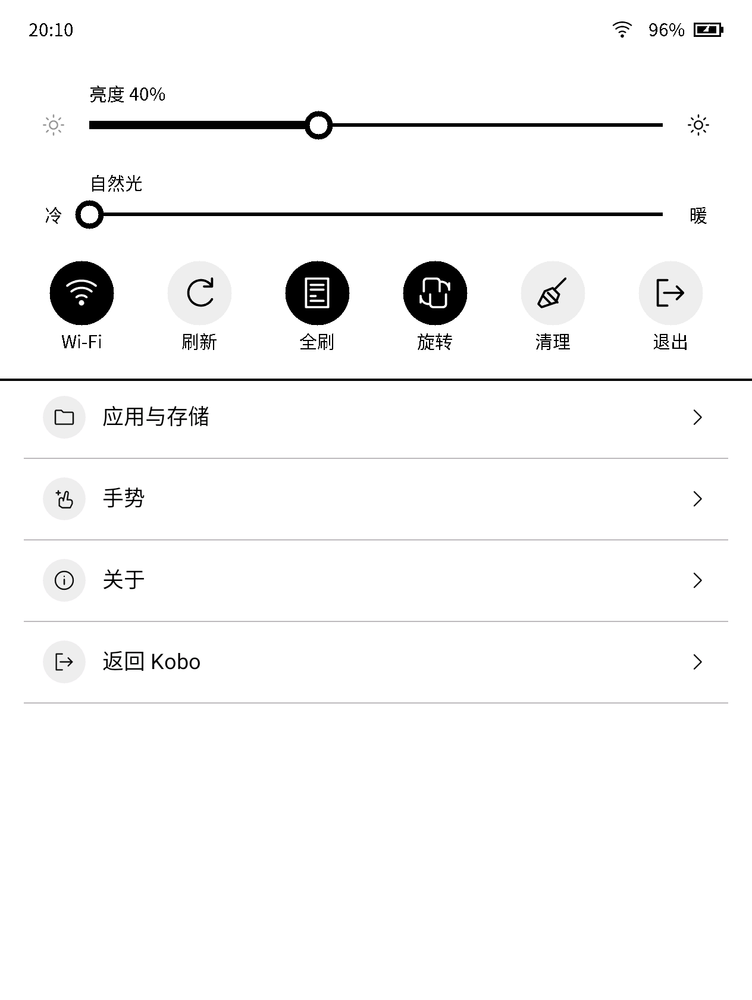

# Kobodroid

在 Kobo Libra Colour 上从 NickelMenu 启动面向墨水屏的 Android 7 会话。原生 Kobo 系统和书库仍可使用。当前预览候选限定在 **N428 / 固件 4.45.23646**。

- [安装、更新与卸载](docs/INSTALL.md)
- [v0.1.0-preview.1 发行说明](docs/RELEASE-NOTES.md)
- [源码目录和构建方法](docs/BUILD.md)
- [发布资产及第三方源码](docs/DISTRIBUTION.md)

原创代码采用 [Apache-2.0](LICENSE)。第三方材料保留各自的许可与署名。

首个 GitHub 预览提供 Libra Colour 安装包、Kobodroid 源码和运行时源码配套资产。安装包包含压缩的空白数据镜像，使用者下载一个对应机型的 ZIP 即可。

## Libra Colour 实机界面

| Android 桌面 | 设置 | 控制中心 |
| --- | --- | --- |
|  |  |  |
